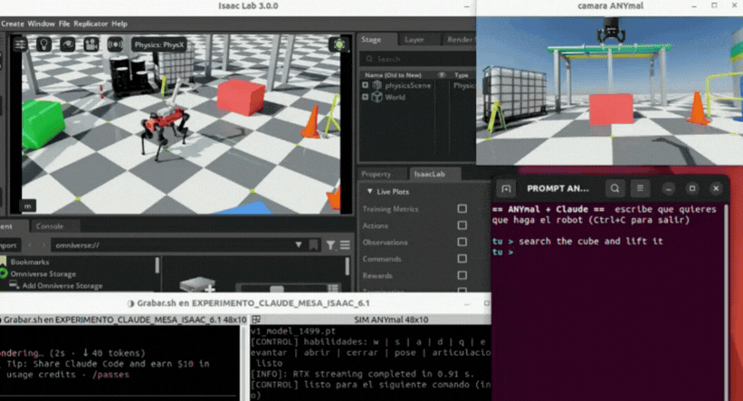
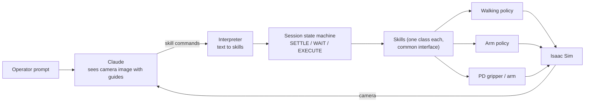
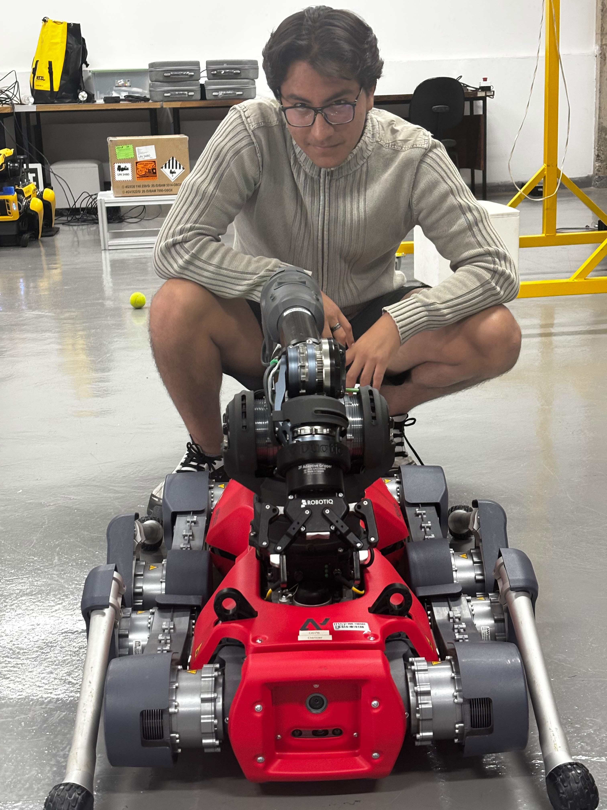

# A vision-language model (Claude) as high-level planner for a learned locomotion policy

**Full video (30-60 s):** [Watch on YouTube](https://www.youtube.com/watch?v=YOUTUBE_ID)

**Problem.** Let a vision-language model drive an ANYmal D in simulation using only the robot camera. The model does not control joints: it chooses skills, and trained policies or PD controllers execute them.

Scene: oil-platform process plant with three tables (red, blue, green) and a cube. Isaac Lab 3.0 / Isaac Sim 6.1.

## Skills the model can call

| Command | Skill | Executed by |
|---|---|---|
| walk a measured distance / turn a measured angle | locomotion | learned walking policy + odometry |
| lift the cube | manipulation | learned arm policy |
| open / close gripper | gripper | PD controller |
| hold an arm pose | arm pose | PD controller |
| "arrived" | check against simulator ground truth (for the operator only) | evaluation module |

Skills can be chained in one message (for example turn 20 degrees, then walk 1 m).

## Architecture

Adding a skill means adding one file and one registry line; the session and the interpreter do not change.

## The robot

*Me with the ANYmal D at the USP Center for Robotics (CROB).*

## Results

- In 12 of 14 logged navigation runs the robot ended within 0.4 m of a table's parking pose (simulator ground-truth evaluation log).
- Lifting the cube through the model has not worked reliably yet (4 logged attempts: not grasped); next step.

> *Code is confidential (USP Center for Robotics - CROB) and cannot be shared. Available upon request with lab approval.*
